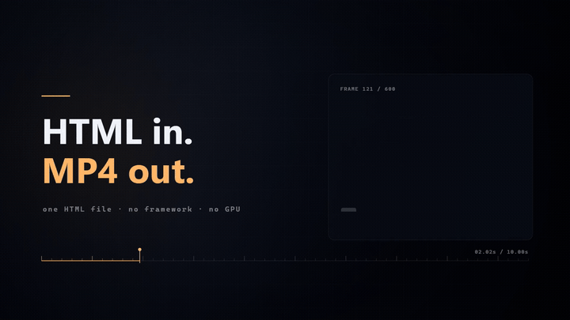

# html-to-video

**English** · [中文](README.md)

[](https://github.com/wx4766/html-to-video/actions/workflows/ci.yml)
[](LICENSE)
[](package.json)

[](docs/demo-hero.mp4)

<sub>That clip is [`docs/demo-hero.html`](docs/demo-hero.html) — 447 lines, zero dependencies. Reproduce it:<br>
`node scripts/render-video-seek.js docs/demo-hero.html --duration=10 --fps=60`</sub>

**Render an HTML/Canvas animation to MP4, frame by frame.**

Not text-to-video. You write a page whose whole output is a pure function of time —
`frame(t)` — and this tool seeks a headless browser to `t`, screenshots, and hands the
frame sequence to ffmpeg.

```
animation.html  ──►  headless Chromium  ──►  N × PNG  ──►  ffmpeg  ──►  out.mp4
                     (seek to t, shoot)
```

Same input, same output. Every time. On every machine that has the same fonts.

---

## Why not Remotion?

Because the thing you already have is an HTML page, not a React app.

Remotion is excellent — if you're building a video editor into a React product, or you
want Lambda-scale cloud rendering, use it. But adopting it means **rewriting your page as
React components**, adding a bundler, and respecting a license that is free for
individuals and teams of ≤3 but paid above that.

This tool asks for one thing: a page that exposes `window.__seek(t)`. No framework, no
build step, no npm package to import in your page. You can literally open the file in a
browser and watch it play, then point the renderer at the same file.

That matters most in one specific workflow: **an LLM wrote the HTML.** Language models
produce a working HTML/Canvas file in one shot far more reliably than they produce a
correct Remotion composition. So the shortest path from "I described a video" to "I have
an MP4" is: LLM → single HTML file → this renderer. Nothing in between to debug.

| | html-to-video | Remotion | Motion Canvas |
|---|---|---|---|
| Mental model | one HTML file + `frame(t)` | React components + `useCurrentFrame()` | TS generator + scene graph |
| Start cost | copy a template, edit `CFG` | scaffold a React project, learn the API | install the editor, learn the API |
| Build step | none — the browser runs it | required | required |
| Preview | open the file in a browser | Remotion Studio | editor |
| License | MIT | free ≤3 people, commercial above | MIT |
| Best at | "turn this page into a video" | video editors inside React apps | hand-tuning storyboards |

Honest summary: **Remotion if you're building a video product; Motion Canvas if you're
crafting shot by shot; this if you have a page and want an MP4.**

---

## 60-second start

```bash
git clone https://github.com/wx4766/html-to-video.git
cd html-to-video
npm install
npx playwright install chromium      # the browser used for screenshots
# ffmpeg must be on PATH (brew install ffmpeg / apt install ffmpeg / winget install ffmpeg)

cp assets/templates/title-card.html my-video.html
node scripts/render-video-seek.js my-video.html --duration=6 --fps=30
# → my-video.mp4
```

Edit the `CFG` block at the top of `my-video.html` to change the copy and data. That's the
whole workflow.

Portrait / any resolution — the templates measure the viewport, so nothing gets cropped:

```bash
node scripts/render-video-seek.js my-video.html --duration=6 --fps=30 --width=1080 --height=1920
```

---

## 10 templates you can ship today

Copy one, edit `CFG`, render. Each template is a single self-contained HTML file.

| Template | What it does |
|---|---|
| `title-card.html` | Title card — characters pop in, then subtitle and tag |
| `bar-chart.html` | Bar chart / ranking — bars grow in sequence, numbers count up, leader highlighted |
| `line-chart.html` | Line trend — line draws itself, points light up, value bubble at the end |
| `number-counter.html` | Big number / KPI — rolls from 0 to target, delta label, progress bar |
| `timeline.html` | Timeline — axis grows, nodes light up one by one |
| `compare.html` | Before / after — two columns plus a verdict strip |
| `flow-steps.html` | Process diagram — steps light up in order, current step highlighted |
| `subtitle-card.html` | Sentence-by-sentence explainer card with a segmented progress bar |
| `vertical-card.html` | 9:16 portrait card for Shorts / Reels / TikTok |
| `vertical-subtitle.html` | 9:16 caption card with `**keyword**` highlighting |

Every template ships in both landscape and portrait layout — the layout picks itself from
the viewport, so `--width/--height` is the only switch.

---

## Project status

`v1.2.0` — used daily, 55 automated tests, MIT. Not a startup, not a framework, no
roadmap theatre. It does one thing and reports its own defects:

- **Deterministic** — same input → byte-identical output, verified by re-rendering
  sampled frames in a fresh page and diffing pixels.
- **Frame-exact** — real 30/60 fps, not interpolated. Seek to any `t`.
- **Text that stays text** — CJK fonts render properly. No garbled glyphs, no invented
  characters.
- **Zero API cost** — everything runs locally.
- **A quality gate** — `scripts/qa.js` measures motion, dead time, frame-to-frame spikes,
  determinism, text framing (clipped / overlapping / inside the platform-UI band) and
  font fallback.
- **Resumable** — `--resume` continues an interrupted render and reuses finished frames
  atomically.

---

## The contract: `frame(t)`

```js
window.__seek = (t) => { /* redraw the whole frame at time t */ };
window.__ready = true;

// The renderer injects window.__seekRender = true.
// Then the page must stop its own clock and be driven purely by __seek.
if (window.__seekRender) { renderAt(0); window.__ready = true; }
else { /* browser preview: requestAnimationFrame loop */ }
```

**Rule: each frame is a pure function of `t`.** No `Math.random()`, no `Date.now()`, no
state carried from the previous frame. Break this and parallel workers drift apart — the
determinism check will say so.

`assets/animation-skeleton.html` implements the contract; start from it.

---

## Features worth knowing about

### Transparent output — put the text layer over real footage

The cheapest good-looking combination right now is an AI-generated background plus a
code-generated text layer (models still mangle type; code places it to the pixel).

```bash
node scripts/render-video-seek.js overlay.html --duration=6 --fps=30 --alpha
# → overlay.mov (ProRes 4444, yuva444p10le, transparent background)
```

In the template, skip the background **including full-screen glows** when
`window.__transparent` is set — skipping only the base colour leaves corner alpha at 12/255
and washes out the plate underneath:

```js
const TRANSPARENT = !!window.__transparent;
if (!TRANSPARENT) { /* base colour, gradients, glows, light sweep */ }
```

Cost, measured on 960×540 / 2 s: H.264 ≈ 118 KB, ProRes 4444 ≈ 760 KB.

**ProRes only — no VP9 alpha.** Encoding the PNG sequence with
`-pix_fmt yuva420p -auto-alt-ref 0` does write alpha data (7.8 KB → 16.8 KB) but Chromium
plays it back with every alpha value at 0 — even the text disappears. Lossless, constant
bitrate and `-lag-in-frames 0` behave the same. Since it can't be verified, it isn't
offered. Export ProRes, then transcode to webm in your NLE if you need small transparent
files.

### Subtitles from a file, not from hard-coded timings

```bash
node scripts/render-video-seek.js subtitle-card.html --duration=8 --srt=voice.srt --cue-log=cues.csv
```

SRT, WebVTT and JSON all parse. The renderer injects `window.__cues` once; templates look
up the current cue by `t` and fall back to their own `CFG.lines` when no file is given.
`--cue-log` writes `frame,t,cue_index,cue_start,cue_end` — subtract the SRT start from the
first frame of each cue and you have the alignment error as a number. Measured on 4 cues
/ 80 frames: **0 ms**.

Keep text out of the bottom 15% — that's the platform UI band. `qa.js` flags
"inside caption band" when you forget.

### Themes — change one field

`assets/templates/themes.js` ships `midnight` (default, dark), `paper` (light, for docs and
projection) and `neon` (black/violet). Templates read `CFG.theme`; pass an object to
override individual fields.

### Resume an interrupted render

```bash
node scripts/render-video-seek.js animation.html --fps=60 --duration=30 --resume
# ▸ resume: reused 1432 frames, 368 to go
```

Frames are written to `.part` and renamed, so a kill never leaves a half-PNG pretending to
be done. If the parameters changed since last time it refuses to mix two batches. Frame
numbers are verified as contiguous before encoding, because a missing frame makes ffmpeg
silently end early.

---

## Honest limitations

- **Not photorealistic.** No camera footage, no atmosphere, no lens. For that use a video
  generation model. This tool is for diagrams, explainers, data animation and titles.
- **Determinism is per-machine.** System fonts (`Microsoft YaHei`, `PingFang SC`) differ
  across machines. Embed a font subset if you need cross-machine reproducibility.
- **Rendering is CPU work.** Roughly 0.5 s per 1080p frame with 4 workers; 10 s at 30 fps
  takes about 2.5 minutes. Use `--stills` while iterating.
- **ffmpeg must be a full build.** Playwright's bundled ffmpeg is compiled
  `--disable-everything`: no H.264, no GIF, not even PNG decode.
- **QA is a smoke detector, not a proof.** Thresholds are empirical. Empty frames, clipped
  text and non-determinism get caught; "this looks boring" does not.
- **Template layouts are tuned per orientation.** Adding a new aspect ratio means checking
  the portrait branch, not just passing new numbers.

---

## CLI

| Flag | Meaning |
|---|---|
| `--duration` / `--from` / `--to` | length in seconds, or a sub-range (output name keeps the range) |
| `--stills=0.5,2.0` | export PNGs at these timestamps, skip encoding |
| `--fps` / `--width` / `--height` | frame rate and resolution |
| `--concurrency` | parallel workers (one Chromium page each) |
| `--audio=<file>` | mux audio after encoding (video stream is copied) |
| `--gop=<sec>` | keyframe interval (`--gop=1` for frame-accurate scrubbing) |
| `--keep-frames` | keep the PNG sequence on success |
| `--resume` | continue an interrupted render |
| `--alpha` | transparent ProRes 4444 output |
| `--srt=<file>` / `--cues=<file>` | external subtitle timeline |
| `--cue-log=<file>` | write the cue alignment CSV |
| `--allow-errors` | don't fail on page errors (default: page errors → non-zero exit) |
| `--no-serve` | load via `file://` instead of the built-in local HTTP server |

Page errors cause a non-zero exit on purpose. A console error usually means a blank frame
or missing content, and an earlier version would happily report "done" until you pulled a
still and looked.

The renderer starts a `127.0.0.1`-only HTTP server to load the page, so `<script
type="module">` and `fetch()` work — otherwise every ESM animation dies on CORS under
`file://`.

---

## As an agent skill

The repo doubles as a WorkBuddy / Claude skill. Drop it into the skills directory and the
assistant can call the renderer directly:

```bash
git clone https://github.com/wx4766/html-to-video.git ~/.workbuddy/skills/html-to-video
cd ~/.workbuddy/skills/html-to-video && bash scripts/install-deps.sh
```

`install-deps.sh` picks a Playwright version that matches your existing browser cache,
installs a full ffmpeg, and records the workspace path.

---

## Tests

```bash
npm test     # 55 cases, ~3 minutes
```

The most important ones are the **control pairs** — a checker that always says "fine" is
worse than no checker:

| Suite | Asserts | Guards against |
|---|---|---|
| `qa-clean` | a healthy template passes | over-strict rules → people stop reading the report |
| `qa-detects` | a deliberately broken page fails | rules quietly relaxed → the gate becomes decoration |
| `qa-offscreen` | text drawn into an offscreen canvas is still found | "invisible = unchecked" |
| `qa-dom-text` | clipped DOM text is reported, multi-line paragraphs are not | fixing false positives by deleting the check |
| `templates-contract` | template capability table matches source, both ways | a capability silently disappearing |

---

## Read more

A long-form write-up of the design decisions, the four bugs that cost the most time, and
the numbers behind the claims:
[Your HTML page is already a video renderer — it just needs one global function](https://dev.to/wx4766/your-html-page-is-already-a-video-renderer-it-just-needs-one-global-function-k31)
(dev.to)

---

## License

MIT.

`assets/lib/motion.js` is adapted from [huashu-art-motion](https://github.com/huashu-art-motion)
(MIT), made self-contained. Credit to the original author.
