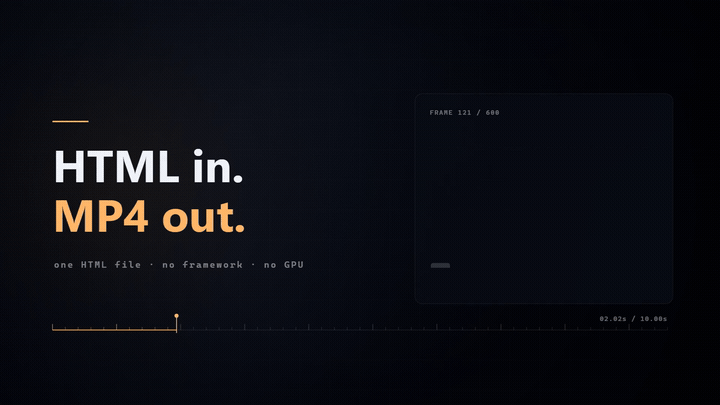
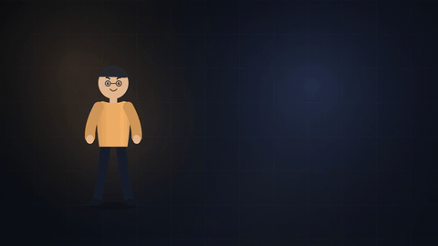
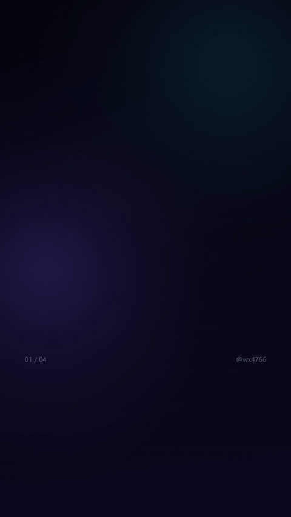
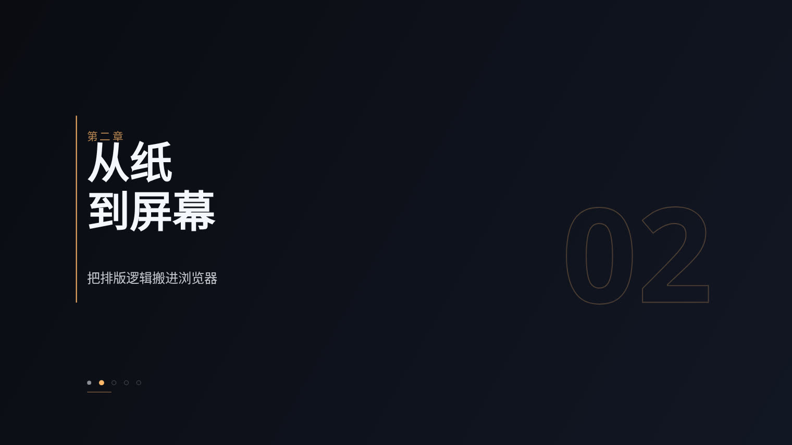
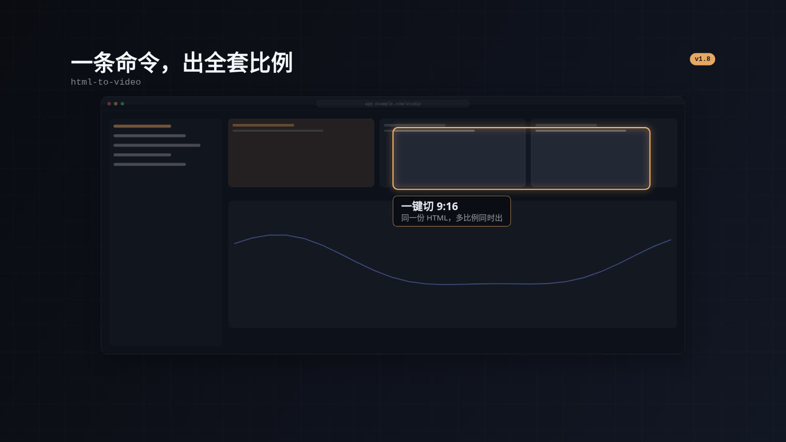

# html-to-video · 用代码逐帧做视频

[English](README.en.md) · **中文**

[](https://github.com/wx4766/html-to-video/actions/workflows/ci.yml)
[](LICENSE)
[](package.json)

[](docs/demo-hero.mp4)

<sub>这段片子就是 [`docs/demo-hero.html`](docs/demo-hero.html)（447 行、零依赖）渲出来的。自己复现一遍：<br>
`node scripts/render-video-seek.js docs/demo-hero.html --duration=10 --fps=60`</sub>

把 HTML / Canvas 动画**逐帧渲染成 MP4**（可配乐、可出 GIF）。

不是 AI 文生视频，而是：

```
写 HTML/Canvas，把画面写成 frame(t) 纯函数
   → 无头浏览器逐帧 seek 到时刻 t，截图
   → ffmpeg 编成 H.264 MP4
```

字幕、运镜、转场全在代码里，**改一行代码重渲即可**。

## 为什么用它

| | |
|---|---|
| **确定性** | 同样的输入永远得到同样的输出，可复现、可版本管理 |
| **可控到帧** | 任意帧率（真 60fps，不是插帧），任意时刻精确对齐 |
| **文字完美** | 中文字体渲染正常，不会像文生视频那样糊成一团或错别字 |
| **零费用** | 本地跑，不调任何 API |
| **有质量门** | 内置自动化验收：确定性、卡顿、跳变、半截字、叠字、字幕带、字体回退 |
| **开箱即用** | 11 个模板改个配置块就出片，不用从零学 canvas |
| **横竖屏都行** | 模板跟视口自适应，16:9 / 9:16 换 `--width/--height` 即可，不裁切 |
| **能出「一支片子」** | 多镜头 + 8 种转场 + 持续运镜，一个 HTML 出整支，不用渲几段再拼 |
| **自带素材** | 40+ 图标 / 参数化人物 / 卡片箭头 / 背景纹理，纯代码零依赖零版权风险 |
| **能叠能配** | `--alpha` 出透明层叠到实拍上；`--srt` 挂外部字幕时间轴 |
| **渲一次发一堆** | `--gif` / `--poster` / `--batch` 一次渲染出成片、动图、封面、批量任务 |

适合：讲解动画、动态图解、产品演示、数据可视化动画、游戏宣传片。
不适合：实拍感 / 氛围镜头（那个应该走 VideoGen）。

### 和 Remotion / Motion Canvas 什么关系

同类工具里最常被拿来比的三个，说清楚各自适合什么，省得你上手才发现选错：

| | html-to-video | Remotion | Motion Canvas |
|---|---|---|---|
| 心智模型 | 一个 HTML 文件 + `frame(t)` 纯函数 | React 组件 + `useCurrentFrame()` | TS 生成器 + 场景图 |
| 起步成本 | 复制模板、改顶部 `CFG` | 建 React 工程、学组件与 API | 装编辑器、学场景 API |
| 构建步骤 | 无，浏览器直接跑 | 要打包 | 要构建 |
| 工程化 | 测试 / CI / 六维 QA | 成熟生态、Lambda 云端渲染、播放器组件 | 编辑器体验好，适合手工精修 |
| 许可 | MIT | 个人与 ≤3 人团队免费，4 人以上需商业许可 | MIT |

**一句话选择**：要在 React 应用里内嵌视频编辑器、或大规模云端渲染 → Remotion 更合适；
要手工一帧帧精修分镜 → Motion Canvas 更合适；
**只想把一屏现成的 HTML 变成 mp4，不想为此建个工程 → 用这个**。

尤其是「AI 写出来的 HTML 动画想变成视频」这种场景：不需要它懂框架，
输出一个能跑的 HTML 就够了，剩下交给渲染器。

### 交给 AI / 脚本跑：最舒服的一条路

这个工具的三条性质凑在一起，正好是「无人值守出片」需要的：

| 性质 | 带来的好处 |
|---|---|
| **镜头表是 JSON** | 让模型产出 `[{kind,dur,title}, ...]` 比让它写 500 行 canvas 代码可靠得多 —— 改片子就是改 JSON |
| **同输入同输出** | 改一句文案重渲，其它帧**逐像素不变**，可以做自动回归，不用担心「顺手改坏了别处」 |
| **有质量门** | `qa.js` 把「黑屏 / 半截字 / 画面卡住 / 混入随机数」变成数字，脚本能自己判断渲坏了没有，不用人盯着看 |

于是闭环是：LLM 写 JSON/HTML → 渲 → QA 自己判红绿 → 红了就照着报告改 → 再渲。
人只在最后看一眼成片。

## 14 个开箱即用模板

拷贝一个，改顶部 `CFG` 里的文案和数据，直接出片。

| | 模板 | 用途 |
|---|---|---|
| [](docs/demo-explainer.mp4) | `assets/templates/explainer.html` | **多镜头讲解片**：片头 → 人物+气泡 → 分条要点 → 条形对比 → 片尾，镜头带转场，可喂 JSON 镜头表；横屏三条要点自动并排成三栏，竖屏另有上下版式 |
| [](docs/demo-title-card.mp4) | `assets/templates/title-card.html` | **片头标题卡**：主标题逐字弹入 + 副标题 + 标签 |
| [](docs/demo-bar-chart.mp4) | `assets/templates/bar-chart.html` | **条形图 / 排名**：条形依次生长，数值同步滚动，第一条高亮 |
| [](docs/demo-line-chart.mp4) | `assets/templates/line-chart.html` | **折线趋势**：折线生长 + 数据点亮起 + 末点数值浮标 |
| [](docs/demo-number-counter.mp4) | `assets/templates/number-counter.html` | **大数字 / KPI**：从 0 滚到目标值 + 涨跌标签 + 进度条 |
| [](docs/demo-timeline.mp4) | `assets/templates/timeline.html` | **时间线 / 流程**：中轴生长，节点逐个点亮 |
| [](docs/demo-compare.mp4) | `assets/templates/compare.html` | **前后对比**：左右两栏对照，底部结论条收口 |
| [](docs/demo-flow-steps.mp4) | `assets/templates/flow-steps.html` | **流程图动画**：步骤依次点亮，当前步高亮外扩 |
| [](docs/demo-subtitle-card.mp4) | `assets/templates/subtitle-card.html` | **逐句解说卡**：一句话一句地出 + 分段进度条，可挂 SRT |
| [](docs/demo-vertical-card.mp4) | `assets/templates/vertical-card.html` | **竖屏 9:16 卡**：大字标题 + 大数字，抖音 / 视频号 / Reels 用 |
| [](docs/demo-vertical-subtitle.mp4) | `assets/templates/vertical-subtitle.html` | **竖屏字幕卡**：`**关键词**` 自动高亮，原生 9:16 版式 |
| [](docs/img/preview-quote-card.jpg) | `assets/templates/quote-card.html` | **引言卡 / 金句**：大引号压底 + 引文逐行推进 + 出处短线，访谈 / 书摘 / 播客切片用 |
| [](docs/img/preview-chapter-card.jpg) | `assets/templates/chapter-card.html` | **章节卡 / 过渡页**：序号水印 + 标题 + 章节进度点，把长片切成几段 |
| [](docs/img/preview-ui-showcase.jpg) | `assets/templates/ui-showcase.html` | **界面演示**：窗口推入 + 缓推 + 两块聚光标注，产品发布 / 功能更新用；也可换成真实截图 |

> 动图只为让你看见「它在动」；**点动图打开原片**看真实画质（横屏 1080p，竖屏 1080×1920）。
> 静帧大图在 `docs/preview-*.png`。

```bash
cp assets/templates/bar-chart.html my-video.html
# 改 my-video.html 顶部的 CFG：title / data / note
bash assets/render.sh my-video.html --duration=6 --fps=60
```

### 横屏 / 竖屏：换两个参数就行

模板都按视口设画布，**不用改代码**：

```bash
bash assets/render.sh title-card.html --duration=6 --fps=60                              # 1920×1080
bash assets/render.sh title-card.html --duration=6 --fps=60 --width=1080 --height=1920   # 9:16
bash assets/render.sh title-card.html --duration=6 --fps=60 --width=1280 --height=720    # 720p
```

模板内部用三档缩放落版：`SX = W/1920`（横向）、`SY = H/1080`（纵向）、
`SF = √(SX·SY)`（字号 / 线宽）。1920×1080 下三者都是 1，所以默认输出保持不变；
换竖屏时字号不缩、版式铺开。自己写的动画照这三行来，就不会出现「改了 --width 只截到左上角」。

> 渲染器现在会主动量画布尺寸，比视口小会明确告警，不再静默出半张图。

### 一稿多发：一条命令出全套平台比例

同一条片子要发抖音、小红书、B 站，剪辑软件里得一个比例一个序列、导一次盯一次。
这里版式本来就是参数化的，多渲一遍只是多一次循环：

```bash
bash assets/render.sh bar-chart.html --duration=8 \
  --presets=douyin,xiaohongshu,square --out=dist/chart.mp4
```

```text
dist/chart-douyin.mp4       1080×1920   抖音 / 快手 / 视频号
dist/chart-xiaohongshu.mp4  1080×1440   小红书 3:4
dist/chart-square.mp4       1080×1080   方版 1:1
```

| 预设 | 尺寸 | 给谁用 |
|---|---|---|
| `douyin` / `tiktok` / `vertical` | 1080×1920 | 抖音、快手、视频号、Reels、Shorts |
| `xiaohongshu` / `xhs` | 1080×1440 | 小红书 3:4 |
| `instagram` / `ig` | 1080×1350 | IG 信息流 4:5 |
| `square` | 1080×1080 | 方版 1:1 |
| `bilibili` / `youtube` / `landscape` | 1920×1080 | 横屏 16:9 |

只想要一个尺寸用 `--preset=xiaohongshu`。**预设名拼错直接报错并列出可用名字**，
不会悄悄按 1920×1080 渲一版比例错误的片子。

一句实话：`--presets` 只保证**尺寸**对，不保证**构图**好看。9:16 和 16:9 的信息密度不同，
同一条内容在 3:4 上可能偏挤 —— 出来自己看一眼，该调字号就调。

另外，竖屏底部那块留白**是故意的**：平台进度条和按钮压在那儿，模板给烧录字幕留了 15% 安全区。

### 配音：没给时长，就按音频长度出片

真实工作流是「写文案 → 配音 → 配画面」，不是先定 6 秒再想办法把配音塞进去：

```bash
bash assets/render.sh title-card.html --audio=voice.m4a --story=shots.json
# ▸ audio: 音频 12.48s，未指定 --duration → 视频按音频定长（12.5s，向上取整到整帧）
```

- **向上取整到整帧**：少半帧就会把最后一个字的尾音削掉。
- 显式给了 `--duration` 且和音频差超过 0.35s 会明确告警 —— 说清差多少、伤在哪边。
  旧版本这里会静默出一支短片：画面后半段整段消失，日志却只有一句 `✓ Done`。
- `--audio-fit=pad`：音频比视频短时补静音，保住整段画面（默认 `trim` 按音轨收尾）。

一个必须说清的边界：`trim` 下成片**不会精确等于音频秒数**。视频流是 `-c:v copy`
直接复制的，ffmpeg 只能按帧包边界收尾，实测会多留 0.3–0.5s。毫秒级对齐得重编码，
那是拿画质换精度，不值得。

### 卡点：让切点落在拍上

所有"看着专业"的片子都遵守同一条潜规则：**切点落在拍上**。
手工对齐是数着秒表挪关键帧，改一句文案又得重来。把拍点算出来交给程序，
"卡点"就从手感变成了参数：

```bash
bash assets/render.sh style-film.html --audio=bgm.mp3 --beats --snap=beats
# ▸ 节拍: 120.14 BPM · 20 个拍点 · 首拍 0.49s · 置信度 0.85
# ▸ 时长对齐拍点: 25.2s → 25.5s（+0.3s）
```

- `--beats` 直接分析 `--audio` 那条音轨；`--beats=beats.json` 用预先算好的网格
  （同一个 BGM 出多条片子时别反复分析）。
- `--snap=beats` 把总时长吸到下一个拍点 —— 成片不会"差 0.2 秒收在半个拍上"。
- `--snap-shots` 把**每个镜头**的时长量化到整拍，这才是"切点真的落在拍上"。
  改动会逐条打印（`3.60s → 3.50s`），幅度超过 25% 会警告 —— 节奏变了得让你知道。
- 模板里也能吃到拍点：`window.__beats` 有 `bpm / beats / downbeats / offset`，
  风格库提供 `SV.pulse(t)`（拍点处为 1、之后衰减）和 `SV.beatPhase(t)`。

分析器是零依赖的（`scripts/beats.js`）：ffmpeg 解成 22.05kHz 单声道 →
对数能量通量 → 自相关估周期 → 扫相位。实测 120BPM 鼓点误差 < 2BPM、相位误差 ~9ms；
纯人声测不出稳定 BPM 时会明确报警（旁白本来就该按句子切，不该按拍切）。

```bash
node scripts/beats.js bgm.mp3 --out=beats.json     # 单独跑，看 BPM 与置信度
```

### 给 Agent 用：`--json`

人读 `✓ Done: xxx.mp4 (1.2 MB · 30fps · 12s)` 没问题，Agent 只能拿正则去猜，
路径里带空格、中文、括号就崩。加 `--json`，stdout 只留一行结果：

```bash
bash assets/render.sh title-card.html --duration=6 --json
```

```json
{"ok":true,"exitCode":0,"output":"…/title-card.mp4","width":1920,"height":1080,
 "fps":60,"duration":6,"frames":360,"bytes":2411724,"warnings":[],"mode":"video"}
```

- 进度与人读日志全部走 stderr，直接 `JSON.parse(stdout)` 即可。
- `warnings` 是数组：参数冲突、音画长度不符、主题名不认识都进这里；空数组 = 干净。
- `duration` 是成片**实际**时长（ffmpeg 读回来的），不是计划值。
- `--presets` 时 `output` 变数组，另附 `presets: [{name,width,height,output,ok,bytes}]`。

### 换配色：改一个字段，或者一条命令

**11 个模板全部接入** `assets/templates/themes.js`。两种换法，效果一样：

```bash
# ① 命令行（推荐）：不改文件，一次渲一个主题
bash assets/render.sh bar-chart.html --duration=6 --theme=paper --out=bar-paper.mp4
```

```js
// ② 写进模板：CFG.theme 一行
const CFG = {
  theme: 'paper',   // midnight（默认，暗色）| paper（浅色）| neon（黑紫霓虹）
  ...
};
```

命令行优先于 `CFG.theme`。名字打错会明确告警并告诉你有哪些可选，不会静默变成默认色。
因为主题是注入的，`--batch` 里每个任务可以各用一套配色 —— 同一份片子出「暗色版 + 浅色版」不用复制文件：

```json
[{ "html": "bar-chart.html", "duration": 6, "theme": "midnight", "out": "bar-dark.mp4" },
 { "html": "bar-chart.html", "duration": 6, "theme": "paper",    "out": "bar-light.mp4" }]
```

上面每条命令都带 `--out`，不是可选项：成片默认叫 `<HTML 名>.mp4`，
同一个 HTML 渲两套配色不换名字，后一个会盖掉前一个。

也可以传对象只覆盖要改的字段：`theme: { bg: '#0B1020', accent: '#22D3EE' }`。

拷模板时记得把 `themes.js` 一起拷到同目录。只拷 HTML 时画面照常出来（模板里有兜底色板），
但 `themes.js` 会 404，而渲染器把「页面报错」判为失败 —— 这时补上文件或加 `--allow-errors`。

### 多镜头与转场：一份 HTML 出整支片子

一支能看的片子是「多镜头 + 转场」，不是几段动画硬拼。用 `assets/lib/scenes.js`
在**同一个 HTML** 里写镜头表，渲染器照旧按 `t` 推帧，转场在页面内合成 ——
不用渲几段再拿 ffmpeg 拼，也不用开剪辑软件：

```bash
bash assets/render.sh explainer.html --duration=17.6 --fps=30 --gif --poster=6.0
```

镜头表也可以整份外置（`--story=shots.json`），**LLM 写 JSON 比写几百行 canvas 代码可靠得多**：

```bash
bash assets/render.sh explainer.html --duration=17.6 --fps=30 --story=shots.json
```

```json
[{ "kind": "title", "id": "hook", "dur": 3.0, "title": "为什么你的构建这么慢" },
 { "kind": "talk",  "id": "why",  "dur": 3.5, "say": "先别急着换工具",
   "who": "dev", "pose": "wave", "trans": { "in": "fade", "dur": 0.45 } }]
```

| 转场 | 观感 | 什么时候用 |
|---|---|---|
| `fade` | 交叉溶解 | **文字类片子的默认** |
| `dip` | 经底色过渡 | 两段情绪差得远，或两镜版式完全换掉 |
| `slide` | 下一镜整块推入 | 满幅图形 / 照片 / 色块之间 |
| `push` | 两镜贴着一起走 | 同上，更要方向感 |
| `rise` | 下一镜从下方升起 | 竖屏、解说卡 |
| `zoom` | 变焦穿过 | 满幅画面之间，「一口气穿过去」 |
| `wipe` | 竖边扫擦 + 扫描亮线 | 科技感、数据揭示（满幅图形） |
| `cut` | 硬切 | 节奏紧，或转场时长给 0 |

> **选型铁律：画面里有文字，就只用 `fade` / `dip`。**
> 带位移的转场会把上一镜的文字从中间切一半推走，两镜标题还会在同一位置叠成乱码 ——
> 观感是「画面坏了」，不是「镜头动了」。位移类转场只留给边缘没有语义的画面。
> `explainer.html` 的 `draw` 包装里有配套的两条纪律（退场先撤内容、进场晚 0.22×转场时长起步），
> 自己写多镜头模板时照抄即可。

转场是**重叠**的：总时长 = Σ镜头时长 − Σ转场时长，加了转场片子不会变长。
`--scene-log=shots.csv` 能导出镜头时间轴（含每镜起止与转场），
**镜头表总时长和 `--duration` 不一致会告警**，免得结尾静默多一截静止画面。

### 自带素材：图标 / 人物 / 运镜

想画图标、箭头、卡片、人物，不用找图也不用从零写 path —— `assets/lib/` 三个零依赖库：

```js
SH.icon(g, 'bolt', x, y, 48, { color: TH.accent, width: 2.5 });          // 40+ 线性图标
SH.card(g, { x, y, w, h }, { fill: TH.panel, radius: 18 });              // 卡片 / 箭头 / 连接线 / 纹理
FIG.draw(g, FIG.preset('dev', { x, y, h, t, pose: 'wave' }));            // 参数化小人 + 对话气泡
CAM.withCam(g, CAM.at(CAM.breath(), t, W, H), W, H, () => drawContent(g)); // 持续运镜，治「画面死了」
```

| 库 | 提供 |
|---|---|
| `shapes.js` | 40+ 图标、卡片 / 胶囊 / 箭头 / 正交连接线 / 虚线框 / 进度弧、网格 / 点阵 / 柔光 / 暗角 / 流动极光 / 胶片颗粒 |
| `figures.js` | 参数化扁平小人：发型 6 种 / 表情 6 种 / 姿势 6 种 / 配色任意，4 个开箱预设，自带 `FIG.say()` 气泡 |
| `camera.js` | `breath` 呼吸、`kenburns` 推拉、`handheld` 确定性手持微抖、`shake` 衰减震动 |

**为什么是代码画的元件而不是预置图片素材包**：版权干净（没有一张外部图）、风格必然统一、
任意分辨率清晰、不占体积。**刻意不做**卡通人物位图包 / 标志性建筑照片包 ——
版权说不清、风格和用户自己的画面打架，还会把仓库撑成几十 MB 的二进制库。

### 透明输出：叠到别人拍的画面上

AI 生成的背景 + 代码生成的文字层，是现在最省钱的组合（模型画文字必糊，代码画文字精确到像素）。

```bash
node scripts/render-video-seek.js animation.html --duration=6 --fps=30 --alpha
# → animation.mov（ProRes 4444 / yuva444p10le，背景透明）
```

模板侧只要两行：读到 `window.__transparent` 为真时**把底色连同全屏光斑一起跳过**
（只跳底色、留着光斑时四角 alpha=12 而不是 0，叠到实拍上整片泛白）：

```js
const TRANSPARENT = !!window.__transparent;
if (!TRANSPARENT) { /* 底色 / 全屏渐变 / 光斑 / 光扫 */ }
```

体积代价（960×540 / 2s）：H.264 约 118 KB，ProRes 4444 约 760 KB。
**只有 ProRes，没有 VP9 alpha** —— 实测 `yuva420p` 能把 alpha 写进文件（7.8 KB → 16.8 KB），
但 Chromium 播出来整帧 alpha 全 0，既然没法自证正确就不作为选项发布。

### 字幕：挂外部时间轴，配音改了字幕跟着走

```bash
node scripts/render-video-seek.js subtitle-card.html --duration=8 --srt=voice.srt --cue-log=cues.csv
```

支持 SRT / WebVTT / JSON。渲染器解析一次、注入 `window.__cues`，模板按当前 `t` 自己查句；
模板里 `--srt` 优先、没有就用自带的 `CFG.lines`。`--cue-log` 输出
`frame,t,cue_index,cue_start,cue_end` CSV —— 每句首帧时间减 SRT 起点就是误差，
实测 4 句 / 80 帧，误差 0 ms。

> 底部 15% 是各平台进度条 / 按钮区，字幕踩进去等于白写；`qa.js` 会提示「进字幕带」。

## 12 种风格：同样的内容，换个样子

模板解决「这段内容怎么排」，风格解决「这支片长什么样」。两者分开之后，
14 个版式 × 12 种视觉语言 = 168 种观感，而不用写 168 个模板。

```bash
bash assets/render.sh assets/style-film.html --duration=13 --theme=chalk     # 黑板粉笔
bash assets/render.sh assets/style-film.html --duration=13 --theme=水墨 --width=1080 --height=1920
```

| 风格 | 一句话 | 适合 |
|---|---|---|
| `riso` 孔版印刷 | 米白纸 + 荧光粉/蓝/绿三套网点（真实印刷网角）+ 标题套印错位 | 观点、数据、独立杂志感 |
| `cutpaper` 剪纸拼贴 | 四边手撕的纸片 + 锐利硬投影 + 两层纸叠着 | 故事、人物、教育 |
| `blueprint` 工程蓝图 | 深蓝 + 20/100px 双层格网 + 四角十字定位标记 + 等宽字 | 技术、架构、API |
| `chalk` 黑板粉笔 | 墨绿板 + 双线抖动笔触 + 粉尘 + 楷体 | 教学、科普 |
| `isometric` 等距线稿 | 白底 + 2:1 等距立体块（顶面/左面/右面）+ 白面遮挡 | 机制、结构、流程 |
| `synthwave` 霓虹复古 | 条纹太阳 + 透视地面网格 + CRT 扫描线 + 色差 | 音乐、游戏、复古科技 |
| `swiss` 瑞士网格 | 白底 + 超大字号 + 单一信号红 + 零圆角 | 品牌、观点、发布会 |
| `ink` 水墨宣纸 | 宣纸纤维 + 三层洇墨 + 朱红印章色 + 大留白 | 国风、文化、历史 |
| `watercolor` 水彩晕染 | 棉浆纸 + 湿画法色晕 + 颜料在边缘沉积的深圈 + 衬线标题 | 人文叙事、品牌故事、教育 |
| `pencil` 铅笔素描 | 素描纸 + 45° 排线 + 双线手绘边框 + 石墨灰阶（几乎不用彩色） | 教程、拆解、草稿感 |
| `vox` 半调解说 | 奶油底 + 大块饱和色 + 大号无衬线 + 半调网点 + 硬投影 | 知识解释、新闻拆解 |
| `clay` 黏土立体 | 淡紫灰底 + 圆角厚块 + 上亮下暗渐变 + 内高光 + 落地投影 | 产品发布、SaaS、年轻品牌 |

`--theme` 也吃中文名（`--theme=水墨` / `--theme=水彩`）。**14 个模板已经全部接上** ——
换的不只是配色，背景整层会换成该风格的纸纹 / 网点 / 格网 / 透视地面：

```bash
bash assets/render.sh assets/templates/bar-chart.html --theme=blueprint --duration=6
bash assets/render.sh assets/templates/explainer.html --theme=riso --duration=18
```

每种风格的签名元素、禁忌、在代码里怎么调、哪个模板配哪种风格，见
**[assets/STYLES.md](assets/STYLES.md)**。

**先看效果，再决定**：

```bash
# 十二宫格：第 k 秒一个风格，出 12 张全屏静帧
node scripts/render-video-seek.js assets/style-gallery.html \
  --stills=0.5,1.5,2.5,3.5,4.5,5.5,6.5,7.5,8.5,9.5,10.5,11.5

# 一支 13 秒的风格短片：片头 / 要点 / 数据 / 片尾
bash assets/render.sh assets/style-film.html --duration=13 --fps=60
```

**一支完整的多风格推广片**：`assets/examples/promo-zh.html` + `promo-zh.story.json`
是 12 镜 / 8 风格 / 85 秒的真实案例，镜头表由配音净时长反推，所以解说、字幕、
画面天然对轴，不用手工卡秒。它演示了两条很实用的做法：每个镜头单独指定
`shot.style`（一镜一风格，蒙太奇一镜里还能连切四种），以及把字幕画在所有镜头
之上（转场时不闪、不随风格变色）。

```bash
node scripts/storyboard.js assets/examples/promo-zh.html \
  --story=assets/examples/promo-zh.story.json --cols=3
node scripts/render-video-seek.js assets/examples/promo-zh.html \
  --story=assets/examples/promo-zh.story.json --duration=85.34 --fps=30 \
  --audio=voice.wav --out=promo.mp4
```

## 先看分镜，再渲全片

60 秒 1080p 逐帧渲要 3~10 分钟。渲完才发现「第 4 镜字太小」，改一轮又是几分钟。
所以先出一页分镜板：

```bash
node scripts/storyboard.js my.html --cols=3 --theme=riso
```

```
my.storyboard/
├── shot-01.png …        每镜一张中点静帧（在转场窗口之外，画面稳定）
├── storyboard.html      带镜头名/时长/时间码/转场的一页板
└── storyboard.png       整页截图，贴给别人问「这样行不行」
```

十几秒出，能看出：镜头时长分配、层级大小、有没有哪一镜是空的、风格跟内容搭不搭。
看不出动效手感与转场顺不顺 —— 那些要出片或 `--stills` 抽帧连看。

## 安装

需要 Node.js >= 18。

**当普通 Node 工具用**（clone 到哪都行，三条命令）：

```bash
git clone https://github.com/wx4766/html-to-video.git
cd html-to-video
npm install
npx playwright install chromium   # 首次必做：下载截图用的浏览器内核
```

另外需要 **ffmpeg 在 PATH 上**（`brew install ffmpeg` / `apt install ffmpeg` / `winget install ffmpeg`）。
别用 Playwright 自带的那个：它是 `--disable-everything` 裁剪版，编不了 H.264。

**当 WorkBuddy / Claude 技能用**（放进技能目录，AI 能直接调用）：

```bash
git clone https://github.com/wx4766/html-to-video.git ~/.workbuddy/skills/html-to-video
cd ~/.workbuddy/skills/html-to-video
bash scripts/install-deps.sh
```

`install-deps.sh` 会自动做完三件事：

1. 探测本机 Playwright 浏览器缓存，挑**匹配的** playwright 版本
2. 装完整版 ffmpeg（同上，避开裁剪版）
3. 把工作区路径写进 `~/.workbuddy/.html2video-env`

想自己指定工作区：`bash scripts/install-deps.sh /path/to/workspace`

## 快速开始

```bash
# 1. 拿骨架模板改自己的动画
cp assets/animation-skeleton.html my-animation.html

# 2. 冒烟：先截几帧确认画面（别跳过）
bash assets/smoke.sh my-animation.html

# 3. 只渲一小段，快速看效果（几秒出片）
bash assets/render.sh my-animation.html --from=3 --to=5 --fps=30

# 4. 全量渲染
bash assets/render.sh my-animation.html --duration=12 --fps=60 --width=1920 --height=1080 --concurrency=4
# → my-animation.mp4

# 5. 交付前验收（确定性问题、卡顿、半截字、叠字、字幕带、字体回退，一次全查）
bash assets/qa.sh my-animation.html --duration=12 --fps=30
```

12 秒 60fps = 720 帧，实测约 6~7 分钟（concurrency=4）。

### 渲染参数

| 参数 | 作用 |
|---|---|
| `--duration` / `--from` / `--to` | 时长 / 只渲某段（秒）。给了范围时输出 `名.起-止s.mp4`，不会覆盖成品 |
| `--stills=0.5,2.0` | 只导出这些时刻的 PNG，不编码 |
| `--fps` / `--width` / `--height` | 帧率与分辨率 |
| `--preset=<名>` | 按平台预设定尺寸（`douyin` / `xiaohongshu` / `instagram` / `square` / `bilibili` …） |
| `--presets=a,b,c` | 一条命令出全套比例，每个比例一个成片（自动加 `-比例名` 后缀） |
| `--concurrency` | 并行 worker 数（每个 worker 一个 Chromium 页面）；给 `auto` 按 CPU 与内存自己挑 |
| `--audio=<file>` | 编码后自动混音；没给 `--duration` 时按音频长度出片 |
| `--audio-fit=trim\|pad` | 音画长度不一致：`trim` 按音轨收尾（默认）／`pad` 补静音保住视频长度 |
| `--beats` / `--beats=<json>` | 分析 `--audio` 的拍点（或用预计算文件），注入 `window.__beats` |
| `--snap=beats` | 总时长吸到下一个拍点 |
| `--snap-shots` | 镜头表里每个镜头的时长量化到整拍（真正让切点落在拍上） |
| `--bpm=<数>` / `--offset=<秒>` | 跳过自动估计，手工给 BPM / 首拍（纯配音想硬卡点时用） |
| `--gop=<秒>` | 关键帧间隔（`--gop=1` 便于后期按秒 seek） |
| `--keep-frames` | 成功也保留逐帧 PNG（换 CRF 重编码不必重截） |
| `--tmpdir=<目录>` | 逐帧 PNG 落到哪块盘（默认挨着 HTML）。1080p 一分钟约 2.4 GB，系统盘紧张时指到别的盘 |
| `--resume` | 上次渲到一半断了？接着渲，已渲好的帧直接复用 |
| `--alpha` | 透明背景输出（ProRes 4444 `.mov`），叠到实拍 / AI 生成画面上用 |
| `--srt=<file>` / `--cues=<file>` | 外部字幕时间轴（SRT / VTT / JSON），注入 `window.__cues` |
| `--cue-log=<file>` | 导出字幕对轴 CSV（`frame,t,cue_index,cue_start,cue_end`） |
| `--story=<file>` | 镜头表 JSON，注入 `window.__story`，整份换掉剧本 |
| `--scene-log=<file>` | 导出镜头时间轴 CSV；镜头表总时长与 `--duration` 不一致会告警 |
| `--gif[=fps,宽]` | 出片后顺手产 GIF（默认 15fps / 宽 960），不重渲 |
| `--poster=<秒>` | 出片后顺手抽一张封面静帧 `.jpg` |
| `--batch=<file.json>` | 一串任务按顺序渲，最后打汇总表；单个失败不连坐已渲好的 |
| `--theme=<名>` | 换主题（`midnight` / `paper` / `neon`），覆盖模板里的 `CFG.theme`；打错名字会告警并回退 |
| `--out=<文件>` | 指定成片路径（默认同目录同名）；一份 HTML 出多套配色时用它，上级目录自动创建 |
| `--json` | stdout 只输出一行结果 JSON（`output` / `duration` / `frames` / `warnings`），日志走 stderr |
| `--headed` | 开着浏览器窗口渲（调试用；并发自动降到 1） |
| `--allow-errors` | 页面报错不判失败（默认有报错就非零退出） |
| `--readytimeout=8` | 等 `__seek` 就绪的秒数（大字体 / 大数据启动慢时调大） |
| `--no-serve` | 用 `file://` 加载页面（默认走本地 http server，见下） |

渲一次发一堆：

```bash
node scripts/render-video-seek.js explainer.html --duration=17.6 --fps=30 \
  --gif=15,960 --poster=6.0        # 成片 + 动图 + 封面，一次渲染全到位
node scripts/render-video-seek.js --batch=jobs.json
# jobs.json = [{ "html":"a.html","duration":6 }, { "html":"b.html","duration":8,"fps":60 }]
```

**渲染结束时如果有页面控制台报错，会非零退出**（成片照样产出，方便核对）。
这是刻意的：报错通常意味着黑屏或缺内容，早年的版本会一路说成功，直到你回抽帧才发现。

### 断点续渲：渲到 80% 崩了，不用从零开始

1800 帧的片子跑到一半被掐掉，最伤的是重来一遍。加 `--resume` 接着渲：

```bash
node scripts/render-video-seek.js animation.html --fps=60 --duration=30 --resume
# ▸ resume: 已复用 1432 帧，还需渲 368 帧
```

三条规则都是为了保证**续出来的片子和一次渲完的片子逐像素一致**：

- 帧先写 `.part` 再改名 —— 被 kill 的那一刻不会留下半张图冒充「已完成」，复用的都是真画完的帧
- 参数变了直接拒绝（`fps` / 尺寸 / 范围任一项不同）—— 两批不同参数的帧混着编码，片子前后节奏会不一致，
  而且**不报错**。报错里会打印「上次 vs 这次」，删不删由你决定
- 编码前按帧号逐个核对连续覆盖 —— 缺一张 ffmpeg 会静默提前收尾，成片莫名变短

临时目录固定为 HTML 旁边的 `.seek-tmp-resume/`（不加 `--resume` 时仍是一次性目录，并发渲互不干扰），
渲完自动清掉；想留着配 `--keep-frames`。

### ESM / fetch 项目直接能渲

渲染器默认起一个**只绑 `127.0.0.1` 的本地 http server** 来加载页面（零新依赖，Node 内置 `http`）。
`file://` 下 `<script type="module">` 和 `fetch()` 会被 CORS 拦死 —— 用 Vite/esbuild 组织的动画、
读本地 JSON 的项目根本起不来；走 http 就没这些事，而且是 `file://` 的严格超集。

渲染开头会打印这个地址，排障时直接粘到浏览器里看控制台最方便。
服务器起不来会自动退回 `file://` 并提示（只警告，不判失败）。

## 一条命令上手：`h2v`

脚本很多（渲染 / 分析 / 分镜 / 验收），记路径和参数很烦。装好依赖后有一个统一入口：

```bash
npx html-to-video doctor                     # 环境自检：缺什么、怎么修（只读不改）
npx html-to-video templates                  # 列出 14 个模板
npx html-to-video styles                     # 列出 12 种风格
npx html-to-video new my-video --template=quote-card
npx html-to-video preview my-video.html --duration=6 --open
npx html-to-video render my-video.html --duration=6 --fps=60
```

它只是把子命令映射到脚本、参数原样透传 —— 和直接 `node scripts/...` 完全等价。

### 改版式不用等渲染：拖时间轴预览

逐帧渲染最反直觉的是"改一句文案要等几分钟才看到效果"，但页面本身暴露了
`window.__seek(t)`。`preview` 就是把它当时间机器用：

```bash
npx html-to-video preview my-video.html --duration=6 --fps=60
# ▸ http://127.0.0.1:41234/tmp/h2v-preview-....html
```

空格播放 / ←→ 单帧步进 / 拖时间轴，看到的每一帧就是渲染器将要截到的画面。
竖屏项目加 `--size=1080x1920`，否则预览框是横的、排版按 16:9 算，容易误判。

### 跑不起来先跑 doctor

```
✓ Node.js          22.13.1
✓ Playwright       1.58.0 · ~/.cache/ms-playwright/chromium-1208/...
✓ Chromium 启动      无头模式可启动
✓ ffmpeg           .../linux-x64/ffmpeg · 含 libx264 + ProRes
⚠ 中文字体            没检测到中文字体，成片里的汉字会变方块
    → apt-get install -y fonts-noto-cjk
```

三类最常见的失败（Playwright 版本与浏览器缓存不匹配、ffmpeg 缺 H.264、缺中文字体）
都能一次看出来，并给出可执行的修法。加 `--json` 给 CI / Agent 用。

## 动画要满足的契约

渲染器靠这两个全局钩子驱动，**必须有**：

```js
window.__seek = (t) => { /* 把 t 时刻的画面完整重绘一帧 */ };
window.__ready = true;

// 渲染器会注入 window.__seekRender = true，
// 此时必须冻结自驱时钟，完全由外部 __seek 推帧（保证确定性）
if (window.__seekRender) { renderAt(0); window.__ready = true; }
else { /* 浏览器预览：requestAnimationFrame 自驱循环 */ }
```

`assets/animation-skeleton.html` 已实现完整契约，直接从它改。

**铁律：每一帧 = 时间 t 的纯函数。** 不要用 `Math.random()` / `Date.now()`，
不要依赖上一帧的状态——否则同输入不同输出，多 worker 并行会各渲各的（验收里的「确定性」会亮红灯）。

**画布就是唯一输出**：`<canvas>` 定位在 `left:0; top:0`，body `margin:0`。
渲染器截左上角，画布必须正好铺满视口、**不能居中**。

**别用这些 class 名**（渲染器注入的 CSS 会无条件隐藏它们，元素会凭空消失）：

```
.no-record .progress .progress-bar .counter .tCur .phases .phase-label
.phase .replay .masthead .kicker .title .footer
```

反过来，想让某块**出现在成片里**，给它加 `data-record-keep="true"` 就能豁免启发式隐藏。

## 动效库：assets/lib/motion.js

缓动、弹簧、步进、错开、拍号的纯函数库，和「冻结时钟 + `__seek(t)`」天然契合。

```html
<script src="../lib/motion.js"></script>
<script>
  const p = MO.expoOut(MO.seg(t, 0.3, 1.4));      // 0..1 进度，快出慢停
  const y = MO.lerp(80, 0, p);
  const s = 1 + MO.settle(t - 1.2, 0.06);         // 到位后的余振
  const items = MO.stagger(t, 5, { t0: 0.4 });    // 5 项依次入场
</script>
```

选缓动：讲解类 `MO.smooth` / `sineInOut`（两端都停稳）；发布会 `MO.appleOut` / `MO.snappy`；
动态大字 `expoOut` + `MO.springHz`；纸片/拼贴 `MO.step(t, 12)` 一拍二。

**别让画面「死」掉**：动效做完后若还要停留数秒，加一点持续微动（慢速光扫、呼吸），
否则观众会觉得视频卡住。模板里都带了这一手。

## 自动化验收：qa.sh

```bash
bash assets/qa.sh my-animation.html --duration=12 --fps=30
```

| 维度 | 量什么 |
|---|---|
| 确定性 | 抽 首/中/末 3 个时刻，各做「同页面 seek 回去」+「全新页面重渲」两轮逐像素比对 |
| 动感 | 运动%、静止帧对比例、**最长连续静止秒数** |
| 流畅 | 相邻帧差峰值/中位数，报「跳变」时刻 |
| 框景 | hook `fillText` / `strokeText` / `drawImage`（离屏画布的文字会跟着贴图追到目标画布）+ DOM 文字按视觉行分块 → 半截字 / 叠字 / 进字幕带 / 近空白 |
| 字体 | 字体是否可用、是否悄悄回退到兜底字体 |
| 报错 | pageerror / console.error（有则判失败） |

产物：`qa/qa.md`、`qa/qa.json`、`qa/<名>.heat.png`（运动热图）。
纯 Node 实现，**零额外依赖**（像素运算借 Chromium 自己解码，不引 numpy / sharp）。

阈值是经验值不是规则：运动 0.5%–8% 多数好看；最长静止 ≥3s 会提示（有意定格可忽略）；
跳变 >0 先去看那一帧；框景线索只是「去看一眼」的提示，不会让验收失败。

**采样间隔要 ≤0.1s**，否则一段快速位移在相邻两帧之间看着就像「跳」——那是采样假象不是穿帮。
间隔 >0.15s 时会提示该把 `--samples` 提到多少。

> 「最长连续静止」超标时，最省事的解法不是加装饰，而是加一点持续运镜
> （`CAM.breath()`，见上）—— 画面在动，观众就不会觉得视频卡住。

## 渲得有多慢：自己量一次

不同机器差 3–5 倍，所以这里不写「约几分钟」这种拍脑袋的数字：

```bash
npm run bench       # 两个页面 × 两档分辨率 × 两种并发 → bench/bench.md
```

表里给 `s/帧`（已含并发）与「10s@60fps 预估」。**并发不是越大越好**：超过 CPU 核数之后
页面之间抢 CPU，`s/帧` 不降反升，表上能直接看出来。

## 配乐与派生格式

```bash
FF="<工作区>/node_modules/@ffmpeg-installer/win32-x64/ffmpeg.exe"   # Windows
# 其它平台：FF="<工作区>/node_modules/@ffmpeg-installer/ffmpeg"

# 混 BGM（0.8s 淡入 / 1.4s 淡出，视频流不重编码）
"$FF" -y -i animation.mp4 -i "$BGM" -filter_complex \
  "[1:a]atrim=0:DUR,afade=t=in:st=0:d=0.8,afade=t=out:st=DUR-1.4:d=1.4,volume=0.5[a]" \
  -map 0:v -map "[a]" -c:v copy -c:a aac -b:a 192k -shortest -movflags +faststart animation-bgm.mp4

# GIF（两阶段 palette 优化，否则糊）
"$FF" -y -i animation.mp4 -vf "fps=15,scale=960:-1:flags=lanczos,palettegen=stats_mode=diff" palette.png
"$FF" -y -i animation.mp4 -i palette.png -lavfi "fps=15,scale=960:-1:flags=lanczos[x];[x][1:v]paletteuse=dither=bayer:bayer_scale=5:diff_mode=rectangle" animation.gif
```

也可以直接让渲染器混音：`--audio=bgm.mp3`。

## 中文字体与跨机器一致

默认用系统字体（`Microsoft YaHei` / `PingFang SC`）。这意味着「确定性」**只在单机成立**——
换台没有这款字体的机器，字形就变了。要跨机器复现就内嵌子集字体：

```css
@font-face { font-family: 'MyCJK'; src: url('fonts/subset.woff2') format('woff2'); font-display: block; }
```

子集化（思源黑体 1.38MB → 约 300KB）：装 `fonttools` 后

```bash
pyftsubset 源字体.ttf --text-file=文案.txt --flavor=woff2 --output-file=subset.woff2
```

只统计会画到画面上的字——把注释里的中文也算进去，子集会胖很多倍。
`qa.sh` 会检查字体可用性并提示「声明的字体其实没生效（悄悄回退了）」。

## 常见问题

**报 `Executable doesn't exist`**
Playwright 版本和浏览器缓存 build 号不匹配。跑 `node scripts/detect-env.js` 看该装哪个版本，
或干脆重跑 `bash scripts/install-deps.sh`。

**Playwright 自带的 ffmpeg 不能用**
`ms-playwright/ffmpeg-*/ffmpeg-win64.exe` 是 `--disable-everything` 编译的，
只有 VP8 + webm，**没有 H.264、没有 GIF、连 PNG 解码都没开**。必须用 `@ffmpeg-installer/ffmpeg` 的完整版。

**chromium 下不下来**
某些网络环境会反复中断。此时正确做法是**复用已有缓存**而不是升级——
`install-deps.sh` 就是为此设计的：它会迁就缓存挑版本。

**Windows 上路径含撇号（如 `C:\Users\O'Brien\...`）**
- bash 里别把路径写进 `${VAR:-默认值}`，撇号会被当引号开始 → `bad substitution`。本项目的配置文件机制就是绕这个的。
- 传给 Node 的路径别用 Git Bash 的 `pwd`（返回 `/c/Users/...`，Node 会解析成 `C:\c\Users\...`）。

**编码中途失败，帧会丢吗**
不会。渲染器会保留 `.seek-tmp-*/` 里的全部 PNG 并打印可直接粘贴的编码命令，不必重截：

```bash
"$FF" -y -framerate 60 -start_number 0 -i .seek-tmp-*/frame-%06d.png -c:v libx264 \
  -pix_fmt yuv420p -crf 18 -preset medium -r 60 -movflags +faststart animation.mp4
```

（`--from` 渲染时把 `-start_number 0` 换成对应的起始帧号。）

**渲染成功但提示「逐帧目录没能自动删除」**
某些沙箱/托管环境给 `fs.rmSync` 套了「批量删除保护」，一次删几十个文件会被拦下。
渲染器会提示并给出目录路径，**成片不受影响**，手动删那个目录即可。

## 目录结构

```
html-to-video/
├── SKILL.md                       技能说明（WorkBuddy 读取）
├── CHANGELOG.md                   更新日志与版本号规则
├── package.json                   可 npm install；engines: node >= 18
├── CONTRIBUTING.md                贡献指南（加模板的四条硬约定在这里）
├── bin/h2v.js                     统一命令入口（render / preview / beats / doctor / styles …）
├── scripts/
│   ├── render-video-seek.js       渲染器内核：冻结时钟 + 逐帧 seek + ffmpeg 编码 + 报错判定
│   ├── beats.js                   节拍分析：ffmpeg 解码 → 能量通量 → 自相关 → 相位对齐
│   ├── preview.js                 浏览器预览服务器（拖时间轴，调 iframe 的 __seek）
│   ├── doctor.js                  环境自检：Node / Playwright / ffmpeg / 字体 / 磁盘
│   ├── qa.js                      自动化验收：确定性/动感/流畅/框景/字体/报错
│   ├── bench.js                   性能基线：量 s/帧，产出 bench/bench.md
│   ├── lib/hide-chrome.cjs        隐藏播放控件的共享规则（渲染器与验收器同一份）
│   ├── lib/local-server.cjs       本地 http 静态服务器（解锁 ESM / fetch，零新依赖）
│   ├── lib/cues.cjs               字幕时间轴解析（SRT / VTT / JSON）
│   ├── lib/qa-rules.cjs           验收判据的纯函数（可单测，也可注入页面）
│   ├── lib/testing.mjs            测试公用件（依赖路径解析 / 子进程 / PSNR 探针）
│   ├── detect-env.js              探测浏览器缓存，输出该装哪个 playwright 版本
│   └── install-deps.sh            一键装依赖并写配置
├── test/
│   ├── render-smoke.test.mjs      真渲两段（16:9 / 9:16），验分辨率与尺寸告警
│   ├── multi-shot.test.mjs        多镜头：镜头表导出一致 / --story 换剧本 / 时长不符告警
│   ├── output-features.test.mjs   --gif / --poster / --batch / --concurrency=auto
│   ├── scenes.test.mjs            镜头时间轴算术（重叠、局部时间、越界、未知转场报错）
│   ├── camera.test.mjs            运镜：确定性、幅度上限、衰减、save/restore 成对
│   ├── lib-draw.test.mjs          素材库：所有图标 / 人物组合不得产生 NaN
│   ├── resume.test.mjs            断点续渲：复用、参数变脸、帧号断档
│   ├── qa-clean.test.mjs          正常模板必须 PASS
│   ├── qa-detects.test.mjs        对照组必须 FAIL（六类缺陷）
│   ├── qa-offscreen.test.mjs      离屏画布的文字必须被追上
│   ├── qa-dom-text.test.mjs       DOM 文字按行分块，多行段落不误报
│   ├── qa-rules.test.mjs          判据纯函数的单测
│   ├── templates-contract.test.mjs 模板契约 + 能力登记表双向校验
│   ├── beats.test.mjs             节拍：BPM / 拍距 / 相位 / 无节拍音频 / 静音
│   ├── render-beats.test.mjs      --beats 注入时机、--snap 吸附、错误参数明确失败
│   ├── cli.test.mjs               h2v 子命令 / new 拷贝依赖 / doctor --json
│   ├── preview.test.mjs           预览服务器可访问、注入 __seekRender、清理临时副本
│   └── fixtures/                  对照组页面（broken / offscreen-text / dom-text / beats-probe）
├── .github/workflows/ci.yml       PR 自动跑 npm test
├── docs/                          README 里用的演示动图 / 原片 / 静帧
│   ├── demo-hero.html             首页那支 10 秒演示片的源文件（447 行，零依赖）
│   ├── demo-*.gif / demo-*.mp4    模板的演示动图与原片
│   ├── explainer-shots.csv        讲解片那支的镜头时间轴（--scene-log 导出）
│   └── preview-*.png              静帧大图
└── assets/
    ├── render.sh                  全量渲染包装器
    ├── qa.sh                      验收包装器
    ├── smoke.sh / smoke.cjs       冒烟测试：验证契约 + 试截关键帧
    ├── animation-skeleton.html    动画骨架模板（已实现完整渲染契约）
    ├── lib/motion.js              动效时间库（缓动/弹簧/步进/错开）
    ├── lib/scenes.js              多镜头时间轴 + 8 种转场
    ├── lib/camera.js              运镜（推拉/呼吸/手持/震动）
    ├── lib/shapes.js              40+ 图标 + 卡片/箭头/连接线/背景纹理
    ├── lib/figures.js             参数化人物 + 对话气泡
    └── templates/                 14 个开箱即用模板
        ├── themes.js              三套内置主题（midnight / paper / neon）
        ├── explainer.html         多镜头讲解片（人物 / 图标 / 转场 / 字幕）
        ├── title-card.html        片头标题卡
        ├── bar-chart.html         条形图 / 排名
        ├── line-chart.html        折线趋势
        ├── number-counter.html    大数字 / KPI
        ├── timeline.html          时间线 / 流程
        ├── vertical-card.html     竖屏 9:16 卡片
        ├── compare.html           前后对比
        ├── quote-card.html        引言卡 / 金句
        ├── chapter-card.html      章节卡 / 过渡页
        ├── ui-showcase.html       界面演示（聚光 + 标注）
        ├── flow-steps.html        流程图动画
        ├── subtitle-card.html     逐句解说卡
        └── vertical-subtitle.html 竖屏字幕卡（关键词高亮）
```

## 开发与测试

```bash
npm install          # 装 playwright（ffmpeg 见上面「安装」，必须是完整版）
npm test             # 99 个用例，约 2 分钟
npm run bench        # 量本机渲染速度 → bench/bench.md
```

测试里有一对**对照组**，这是整个项目最该守住的东西：

| 用例 | 断言 | 防的是什么 |
|---|---|---|
| `qa-clean` | 正常模板必须 PASS | 判据过严 → 天天误报，人就不看了 |
| `qa-detects` | `test/fixtures/broken.html` 必须 FAIL | 判据过松 → 质量门变成装饰 |
| `qa-offscreen` | 离屏画布的文字必须被报出来 | 「看不见 = 查不出」的静默漏洞 |
| `qa-dom-text` | 出界文字要报 / 多行段落不许报 | 修误报时顺手把检查关掉 |
| `templates-contract` | 模板能力表与源码双向对齐 | 能力被悄悄删掉没人发现 |
| `scenes` | 转场重叠与局部时间的算术 | 「某个镜头少了半秒」这种肉眼看不见的错 |
| `camera` | 运镜确定性、幅度上限、save/restore 成对 | NaN 进 transform（画面整帧消失但不报错）、变换逐帧叠加 |
| `lib-draw` | 所有图标 / 人物组合不得产生 NaN | 同上：素材库的静默失败 |

只调松不放对照组，等于把质量门拆了。改 `scripts/qa.js` 时全部跑一遍。

## 贡献

欢迎 PR。**最需要的是新模板**——尤其是需要和声音 / 数据联动的（波形动画、地图轨迹、真实数据接进来的图表）。

加模板的四条硬约定（渲染契约 / 画布跟随视口 / 字幕安全区 / 别定格太久）写在
[CONTRIBUTING.md](CONTRIBUTING.md)，照 `assets/templates/title-card.html` 抄骨架最快。
加了模板记得在 `test/templates-contract.test.mjs` 的 `CAPS` 里登记它的能力（主题 / 字幕 / 透明），
CI 会检查源码和能力表是否对得上。

提 Bug 请带上**复现命令**和 `qa/qa.md` —— 比贴截图有用得多。

## License

MIT

`assets/lib/motion.js`（动效时间库）移植自 [huashu-art-motion](https://github.com/huashu-art-motion) 的
`scripts/engine/lib/motion.js`（MIT），去掉了对原作者引擎的依赖，改成自包含。感谢原作者。
